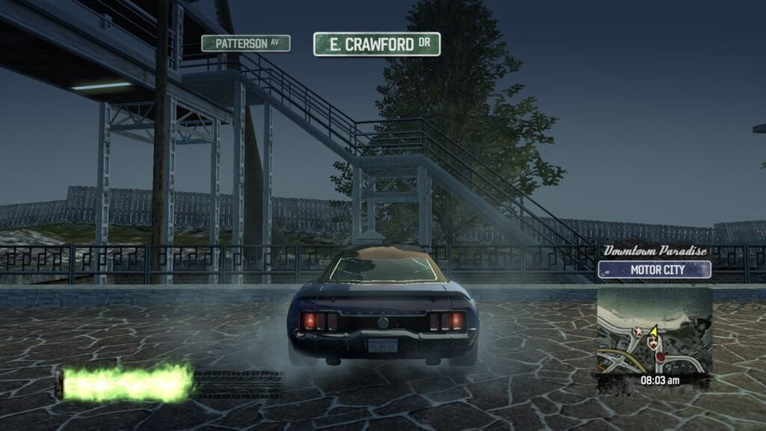
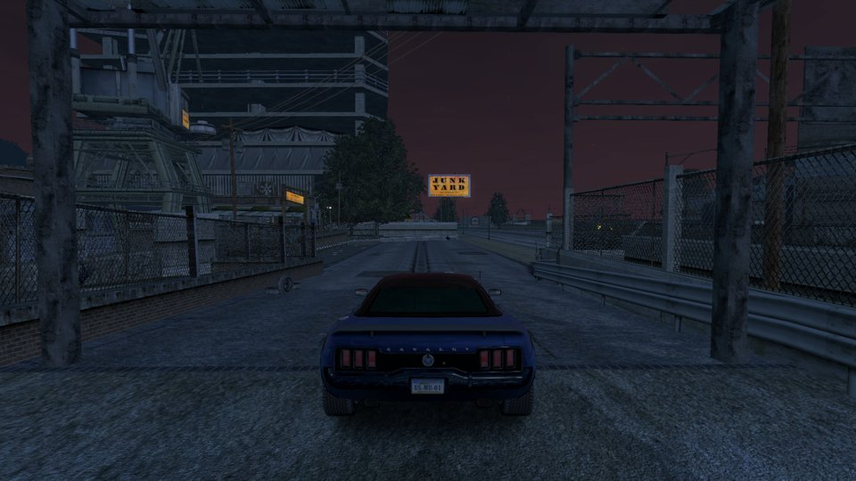
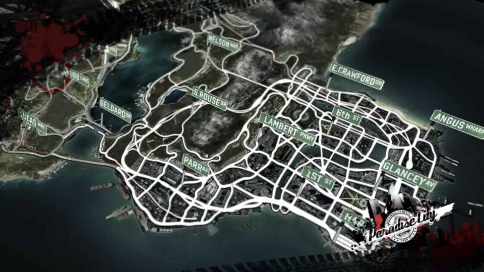
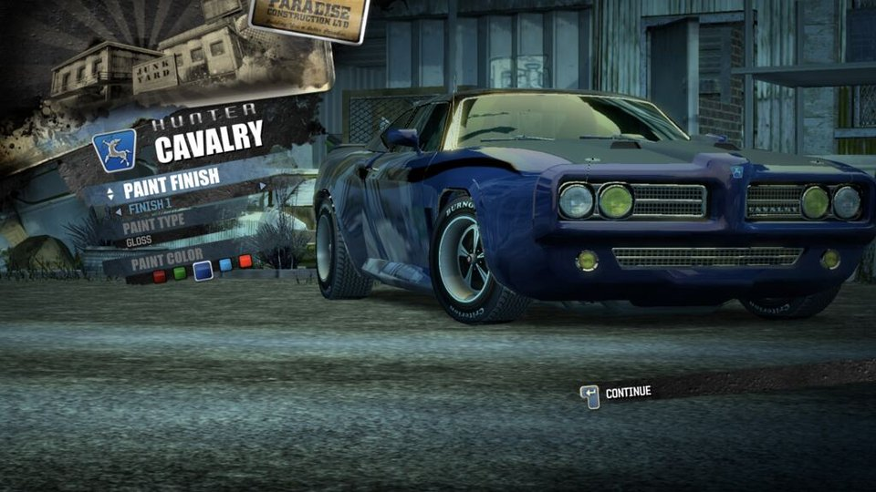
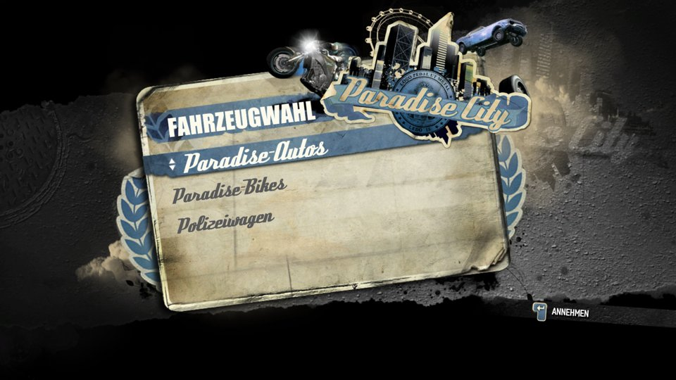
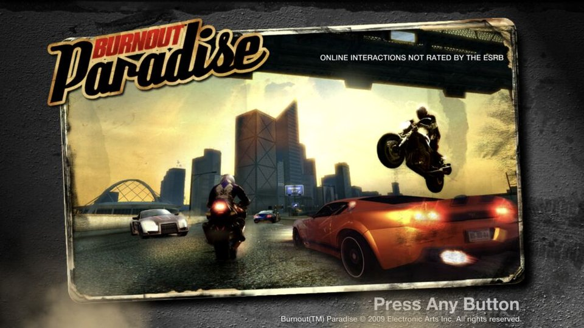

# Burnout Paradise: The Ultimate Box – Android-Port (selbst bauen)

Die PC-Version von **Burnout Paradise: The Ultimate Box** als native Android-App (arm64), offline
spielbar. Der Port ist eine **statische Rekompilierung**: Der x86-Code von `BurnoutParadise.exe`
wird vorab nach C übersetzt und für ARM64 kompiliert. Eine eigens geschriebene Windows-Laufzeit
ersetzt kernel32/user32/Winsock/DirectInput/XInput, Direct3D 9 läuft über DXVK auf Vulkan, der Ton
über AAudio. Kein Emulator, kein Wine, kein Box64 auf dem Gerät.

**Hier gibt es keine fertige APK und nichts aus dem Spiel.** Du baust die APK selbst aus **deiner
eigenen** Steam-Kopie: Der Build übersetzt deine EXE auf deinem Rechner. Dieses Repository enthält
nur Werkzeuge, die Laufzeit und eine Liste von Funktionsadressen (keinen Spielcode). Die Spieldaten
(Bundles, Sounds, Videos …) werden aus deiner Kopie aufs Gerät kopiert. Die gebaute APK enthält aus
deiner EXE übersetzten Code — sie ist für dich, nicht zum Weitergeben. Burnout Paradise ist
© Electronic Arts / Criterion Games; dieses Projekt ist weder mit ihnen verbunden noch von ihnen
unterstützt.

*English version: [README.md](README.md)*

## Screenshots

<table>
  <tr>
    <td width="50%"><br><sub>Freie Fahrt in Motor City auf dem AYN Odin 3, 60 fps</sub></td>
    <td width="50%"><br><sub>Ausfahrt aus dem Schrottplatz (APK aus diesem Repository gebaut)</sub></td>
  </tr>
  <tr>
    <td width="50%"><br><sub>Karte von Paradise City</sub></td>
    <td width="50%"><br><sub>Lackiererei</sub></td>
  </tr>
  <tr>
    <td width="50%"><br><sub>Fahrzeugwahl mit den optionalen Polizeiwagen aus der Remastered-Ausgabe</sub></td>
    <td width="50%"><br><sub>Titelbild</sub></td>
  </tr>
</table>

## Stand

Spielbar, experimentell. Auf dem Gerät geprüft: Titelbild, Menüs, Spielstände, freie Fahrt durch
Paradise City, Schrottplatz, Lackiererei, Karte, der eingebaute Controller und die Spielsprache nach
der App-Sprache. Der komplette Bauweg dieses Repositorys wurde durchlaufen (Lift, Capture, ARM64-Build,
APK) und die so gebaute APK auf dem Gerät gespielt.

| Gerät | GPU | Ergebnis |
|---|---|---|
| AYN Odin 3 (Android 15) | Adreno 830 | 56–60 fps beim Fahren (60-Hz-Modus, 2-Minuten-Messung); 92–105 fps im 120-Hz-Modus (kurze Fahrt) |

Noch nicht gemessen: lange Sitzungen mit viel Verkehr und vielen Unfällen.

## Was du brauchst

- Deine Steam-Kopie von **Burnout Paradise: The Ultimate Box**, genau dieser Build:
  `BurnoutParadise.exe` 1.1.0.0, SHA-256
  `fa55ff4d5b0f0f1e7a3dd861ec765d1d81c51554b588ae9872a3f923686f41be`. Der Build prüft das. Im
  Spielordner muss außerdem `DirectX/Mar2008_d3dx9_37_x86.cab` liegen, denn daraus kommt der
  spieleigene Shader-Compiler.
- Zum Bauen: ein x86-64-Rechner mit **Docker** (Linux oder Windows mit WSL2) und **adb**,
  **≥ 16 GB RAM**, **~30 GB freier Platz** und Internet, während das Builder-Image entsteht. Der
  Build selbst läuft danach ohne Netz.
- Zum Spielen: ein Android-Gerät mit 64-Bit-ARM, **Vulkan 1.1+**, Android 10+, ~4 GB frei und ein
  Gamepad (eingebaut, USB oder Bluetooth). Getestet: **AYN Odin 3** (Snapdragon 8 Elite).

## Bauen

```sh
git clone https://github.com/zwaetschge/burnout-paradise-android.git
cd burnout-paradise-android
./build.sh "/pfad/zu/Burnout Paradise The Ultimate Box"     # der Ordner mit BurnoutParadise.exe
```

Ergebnis: `out/BurnoutParadise-Android-<version>.apk` und `out/device/` (Codepage-Tabellen und
Shader-Cache fürs Gerät).

Was `build.sh` macht (in Docker; Details in `scripts/build-inside-docker.sh`):

1. prüft den SHA-256 der EXE und baut das Builder-Image (`docker/Dockerfile.builder`: Android-SDK/NDK,
   Wine, Mesa lavapipe, DXVK und der Lifter pcrecomp in fester Version mit den Änderungen dieses Ports
   in `patches/`)
2. **hebt** x86 → C: den `.text`-Abschnitt mit der Funktionsliste in `seeds/` (nur Adressen), danach
   Trampoline und Port-Patches (`tools/port_patches.py`); die C-Quellen bleiben in `work/gen`
3. **Capture**: startet das Spiel ohne Fenster auf dem Baurechner (lavapipe + DXVK) und fährt
   45 Minuten durch die Stadt (`--capture-minutes N`). Dabei wird der Code übersetzt, den das Spiel zur
   Laufzeit aus seinen Sound-Bundles lädt, und die angeforderten Shader werden mit der spieleigenen
   `d3dx9_37.dll` unter Wine kompiliert
4. kompiliert `libburnout_static.so` für arm64 mit dem Android-NDK (16-KiB-Seiten)
5. packt und signiert die APK; der Schlüssel bleibt in `work/` und wird wiederverwendet, damit sich
   Updates über die vorige Version installieren lassen

Gemessen: Der ARM64-Build dauert ~5 Minuten auf 14 Kernen, dazu kommen die 45 Minuten Capture-Fahrt.
`JOBS=4 ./build.sh …` begrenzt die parallelen Compiler; `--stage lift|capture|lib|apk` führt einen
Schritt einzeln aus.

## Installieren und spielen

1. `adb install -r out/BurnoutParadise-Android-<version>.apk`
2. `./scripts/prepare-game-files.sh --game-dir "/pfad/zu/Burnout Paradise The Ultimate Box"`
   kopiert deinen Spielordner nach `Android/data/dev.plum.burnoutport/files/BurnoutPR/`, dazu die
   Codepage-Tabellen und den Shader-Cache, und schreibt die Starteinstellungen (`port.env`).
3. **Burnout Paradise** starten und auf dem Titelbild eine Taste drücken.

Spielstände liegen in der App (`files/user`). Ein neuer Build installiert sich über den alten, wenn er
mit demselben Schlüssel signiert ist (derselbe `work/`-Ordner). Ist eine anders signierte Version
installiert, diese zuerst deinstallieren; dabei gehen die Spielstände verloren.

### Wenn das Spiel anhält: fehlender Shader oder Code

Auf dem Gerät gibt es weder Shader-Compiler noch Lifter. Braucht das Spiel etwas, das der Capture-Lauf
nicht gesehen hat, hält der Port mit einer Meldung in
`Android/data/dev.plum.burnoutport/files/port-runtime.log` an und legt die Anfrage auf dem Gerät ab.
In den ersten Sitzungen ist das ein paar Mal zu erwarten; jede Ergänzung bleibt dauerhaft.

- *„shader not in cache“* → `./scripts/shader-topup.sh --game-dir "/pfad/zu/…"` kompiliert die
  angeforderten Shader und schiebt sie zurück.
- *„PORT_DYN capture: code at 0x… is not translated“* (Code aus den Sound-Bundles) →
  `./scripts/code-topup.sh --game-dir "/pfad/zu/…"` übersetzt das gespeicherte Speicherfenster, baut
  die APK neu und installiert sie.

Danach das Spiel neu starten.

## Was funktioniert

- Titelbild, Menüs, freie Fahrt durch Paradise City, Schrottplatz, Lackiererei, Karte; der
  Fortschritt wird gespeichert.
- Die Spielsprache folgt der App-Sprache (Android-Einstellungen → Apps → Burnout Paradise → Sprache)
  oder `PORT_LANGUAGE` in `port.env`.
- **Steuerung:** der eingebaute Controller eines Handhelds oder ein USB-/Bluetooth-Gamepad, gelesen
  über den spieleigenen XInput-Weg (der Port zeigt dem Spiel das Pad wie Windows). Ohne Pad gibt es
  einfache unsichtbare Touch-Zonen: In der unteren Bildschirmhälfte lenkt das linke Viertel nach
  links, das zweite nach rechts, das dritte bremst und das rechte gibt Gas; ein Tipp in die obere
  Hälfte bestätigt in Menüs.
- Standardmäßig **60 Hz**; ein **120-Hz**-Simulationsschritt lässt sich einschalten (`PORT_SIM_HZ=120`).
- Offline: Die Meldung „Verbindungsproblem“ nach dem Start wird automatisch bestätigt.
- **Optional Remastered-Fahrzeuge:** Wenn du auch *Burnout Paradise Remastered* besitzt, lassen sich
  dessen 41 zusätzliche Fahrzeuge (33 Polizeiautos, Big-Surf-Island-Autos, Toy-Legenden) in ein
  Overlay umwandeln, mit eigenem Reiter „Cop Cars“, Werkstattbildern und Texten — siehe
  [docs/REMASTERED-CARS.md](docs/REMASTERED-CARS.md).

## Was nicht funktioniert

- Online-Spiel und alles, was EA-Server braucht.
- Vibration (noch nicht an den Vibrationsmotor angeschlossen).
- Kein Touch-Gamepad auf dem Bildschirm; die Touch-Zonen sind nur ein Notbehelf, ein Gamepad wird
  dringend empfohlen.
- Nur der Steam-Build 1.1.0.0 wird unterstützt (Funktionsliste und Patches sind darauf festgelegt).

## Einstellungen (`port.env`)

`scripts/prepare-game-files.sh` schreibt die Startzeilen in
`Android/data/dev.plum.burnoutport/files/BurnoutPR/port.env` (`PORT_OEP`, `PORT_NLS`,
`PORT_SHADER_CACHE`, `PORT_OFFLINE`). Optionale Zeilen, die du ergänzen kannst (sie bleiben beim
erneuten Lauf des Skripts erhalten):

| Schlüssel | Wirkung |
| --- | --- |
| `PORT_LANGUAGE=de` | Spielsprache (`de`, `fr_fr`, `en_uk`, …); Standard: App-Sprache |
| `PORT_SIM_HZ=120` | 120-Hz-Simulationsschritt (Standard 60) |
| `PORT_GAMEPAD=0` | Pad in Tasten übersetzen statt nativem XInput |
| `PORT_MOD_ROOT=0` | `port-mods`-Overlay (Remastered-Fahrzeuge) abschalten |
| `PORT_ONLINE_ERROR=1` | Meldung „Verbindungsproblem“ zeigen statt sie zu bestätigen |

## Für Entwickler

- `runtime/` Windows-Laufzeit (Speicher, Threads mit fairem Scheduler für eine Gast-CPU, Dateien,
  Registry, Gebietsschema, Winsock, DirectInput/XInput/WMI, DirectSound → AAudio, Direct3D 9 → DXVK,
  D3DX-Shader-Cache), `android/` die NativeActivity-App, `tools/` Lifter-Treiber, Trampolin-Pass,
  Port-Patches, Paket für Laufzeit-Code, APK-Paketierung, `tools/d3dxcc` (Shader-Compiler-Host für
  Wine), `tools/remastered_cars` die Fahrzeug-Umwandlung, `seeds/` die Funktionsliste, `patches/`
  Änderungen an pcrecomp und DXVK, `docker/` das Builder-Image, `scripts/` Bau- und Geräteskripte.
- Wie alles zusammenhängt: [docs/ARCHITECTURE.md](docs/ARCHITECTURE.md).
- Vor dem Pushen eines Forks oder Pull Requests `python3 scripts/audit-clean-tree.py` ausführen: Es
  schlägt bei Spieldateien, Binärdateien, privaten Pfaden und Schlüsseln fehl.

## Rechtliches

Dieses Repository enthält keine Dateien und keinen Code aus Burnout Paradise, nur eigenen Code,
Adresslisten und Werkzeuge. Du baust mit deiner eigenen, rechtmäßig erworbenen Kopie; die APK ist nur
für dich. Der Port startet den eigenen Code des Spiels an dessen Einstiegspunkt in `.text`; der
Steam-Wrapper wird übersprungen, nicht ausgeführt, und nichts wird entschlüsselt. Burnout, Burnout
Paradise und Criterion sind Marken von Electronic Arts Inc.; dieses Projekt ist weder mit Electronic
Arts, Criterion Games noch Valve verbunden.

## Lizenz

Der Code dieses Projekts steht unter der **MIT-Lizenz** ([LICENSE](LICENSE)). Fremdsoftware, die der
Build in festen Versionen holt oder installiert: pcrecomp (MIT; die Änderungen in `patches/` ebenfalls
MIT), DXVK (zlib), Wine (LGPL-2.1, nur Baurechner), Mesa lavapipe (MIT, nur Baurechner),
Android-NDK/SDK (Apache-2.0). Details: [THIRD_PARTY_NOTICES.md](THIRD_PARTY_NOTICES.md).
