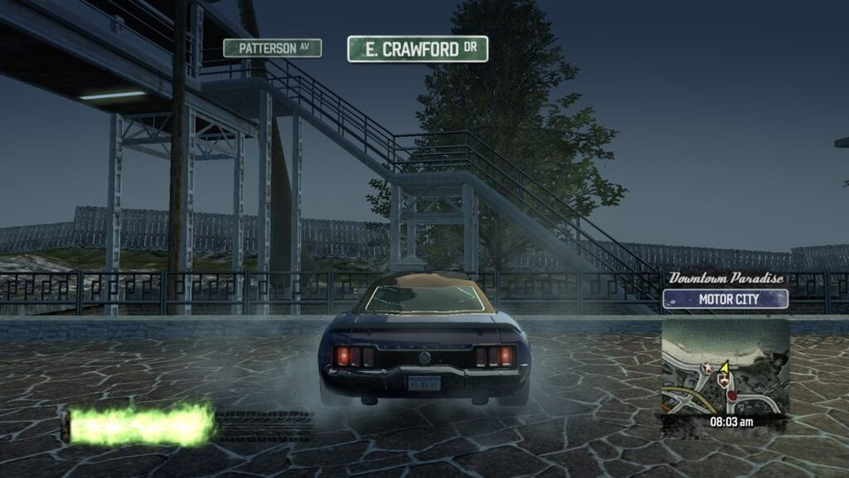
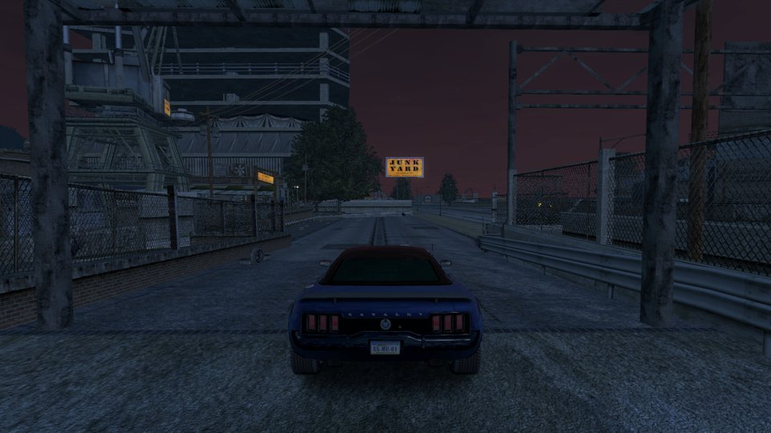
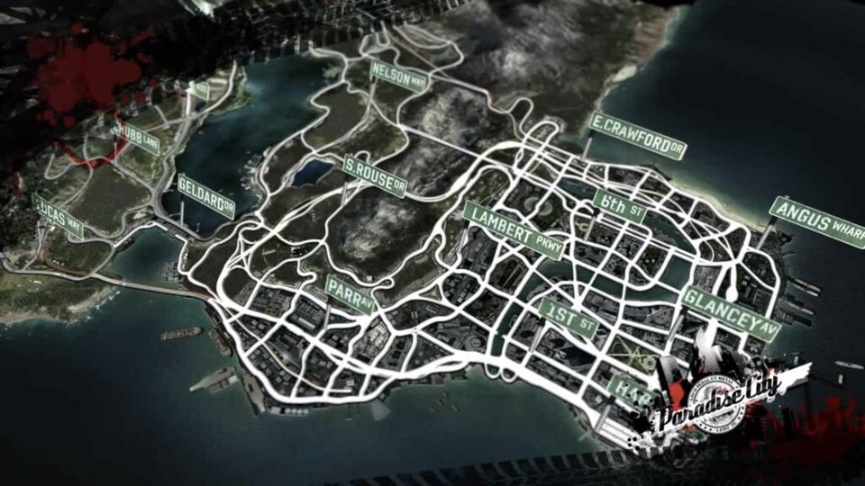
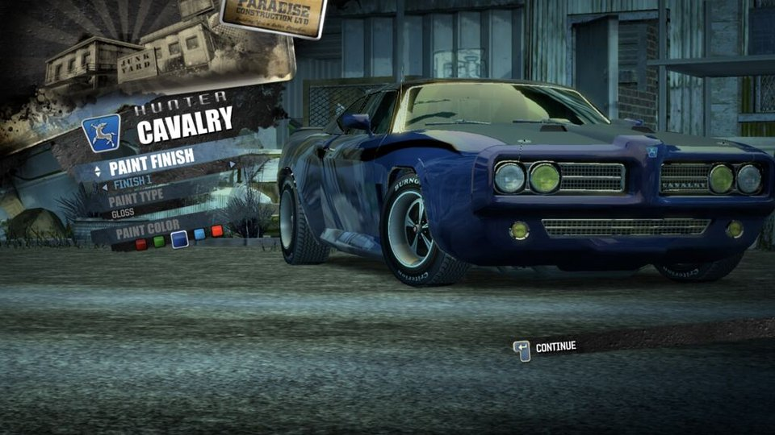
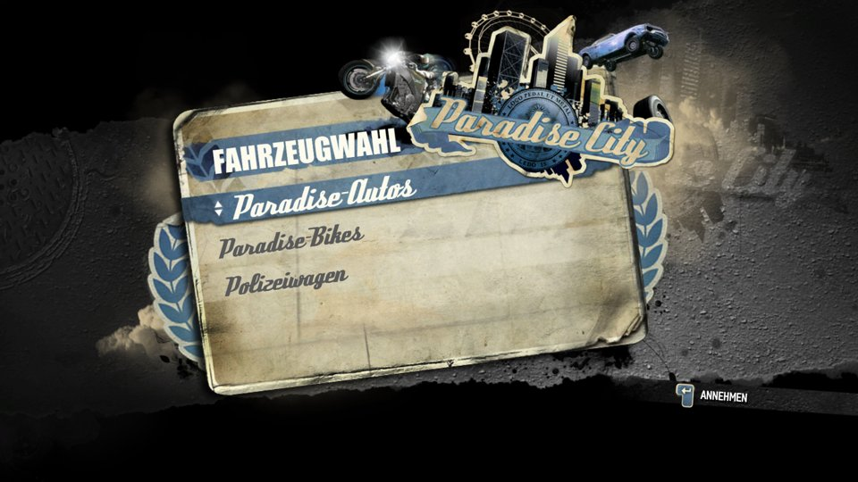
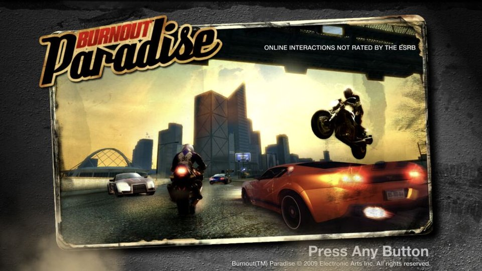

# Burnout Paradise: The Ultimate Box – Android port (build it yourself)

The PC version of **Burnout Paradise: The Ultimate Box** as a native Android app (arm64), playable
offline. The port is a **static recompilation**: the x86 code of `BurnoutParadise.exe` is translated
ahead of time to C and compiled for ARM64. A Windows runtime written for this project replaces
kernel32/user32/Winsock/DirectInput/XInput, Direct3D 9 runs on Vulkan through DXVK, and sound goes
through AAudio. No emulator, no Wine, no Box64 on the device.

**There is no prebuilt APK here and nothing from the game.** You build the APK yourself from
**your own** Steam copy: the build translates your EXE on your machine. This repository only holds
tools, the runtime and a list of function addresses (no game code). The game data (bundles, sounds,
videos …) is copied from your copy to the device. The APK you build contains code recompiled from
your EXE, so it is for you, not for sharing. Burnout Paradise is © Electronic Arts / Criterion Games;
this project is not affiliated with or endorsed by them.

*Deutsche Version: [README.de.md](README.de.md)*

## Screenshots

<table>
  <tr>
    <td width="50%"><br><sub>Free roam in Motor City on the AYN Odin 3, 60 fps</sub></td>
    <td width="50%"><br><sub>Leaving the junkyard (APK built with this repository)</sub></td>
  </tr>
  <tr>
    <td width="50%"><br><sub>Map of Paradise City</sub></td>
    <td width="50%"><br><sub>Paint shop</sub></td>
  </tr>
  <tr>
    <td width="50%"><br><sub>Vehicle select with the optional cop cars from the Remastered edition (German UI)</sub></td>
    <td width="50%"><br><sub>Title screen</sub></td>
  </tr>
</table>

## Status

Playable, experimental. Verified on device: title screen, menus, saves, free roam through Paradise
City, junkyard, paint shop, map, the built-in gamepad, and the game language following the app
language. The full build path of this repository was run end to end (lift, capture, ARM64 build,
APK) and the resulting APK was played on the device.

| Device | GPU | Result |
|---|---|---|
| AYN Odin 3 (Android 15) | Adreno 830 | 56–60 fps driving (60 Hz mode, 2-minute measurement); 92–105 fps in the 120 Hz mode (short drive) |

Not measured yet: long sessions with heavy traffic and many crashes.

## What you need

- Your Steam copy of **Burnout Paradise: The Ultimate Box**, exactly this build:
  `BurnoutParadise.exe` 1.1.0.0, SHA-256
  `fa55ff4d5b0f0f1e7a3dd861ec765d1d81c51554b588ae9872a3f923686f41be`. The build checks this. The
  game folder also has to contain `DirectX/Mar2008_d3dx9_37_x86.cab`, because the game's own shader
  compiler comes from there.
- To build: an x86-64 machine with **Docker** (Linux, or Windows with WSL2) and **adb**,
  **≥ 16 GB RAM**, **~30 GB free disk**, and internet access while the builder image is created.
  The build itself then runs without network.
- To play: an Android device with 64-bit ARM, **Vulkan 1.1+**, Android 10+, ~4 GB free, and a
  gamepad (built in, USB or Bluetooth). Tested: **AYN Odin 3** (Snapdragon 8 Elite).

## Build

```sh
git clone https://github.com/zwaetschge/burnout-paradise-android.git
cd burnout-paradise-android
./build.sh "/path/to/Burnout Paradise The Ultimate Box"     # the folder with BurnoutParadise.exe
```

Result: `out/BurnoutParadise-Android-<version>.apk` and `out/device/` (code-page tables and shader
cache for the device).

What `build.sh` does (in Docker; details in `scripts/build-inside-docker.sh`):

1. checks the EXE's SHA-256 and builds the builder image (`docker/Dockerfile.builder`: Android
   SDK/NDK, Wine, Mesa lavapipe, DXVK, and the lifter pcrecomp at a pinned version with this port's
   changes in `patches/`)
2. **lifts** x86 → C: the `.text` section with the function list in `seeds/` (addresses only),
   then trampolines and port patches (`tools/port_patches.py`); the C sources stay in `work/gen`
3. **capture**: runs the game headless on the build machine (lavapipe + DXVK, no window) and drives
   through the city for 45 minutes (`--capture-minutes N`). It translates the code the game loads at
   run time from its sound bundles and compiles the shaders the game asks for with the game's own
   `d3dx9_37.dll` under Wine
4. compiles `libburnout_static.so` for arm64 with the Android NDK (16 KiB pages)
5. packs and signs the APK; the key stays in `work/` and is reused by later builds, so updates
   install over the previous version

Measured: the ARM64 compile takes ~5 minutes on 14 cores; the capture drive adds its 45 minutes.
`JOBS=4 ./build.sh …` limits the parallel compilers; `--stage lift|capture|lib|apk` runs one step.

## Install and play

1. `adb install -r out/BurnoutParadise-Android-<version>.apk`
2. `./scripts/prepare-game-files.sh --game-dir "/path/to/Burnout Paradise The Ultimate Box"`
   copies your game folder to `Android/data/dev.plum.burnoutport/files/BurnoutPR/`, plus the
   code-page tables and the shader cache, and writes the start-up settings (`port.env`).
3. Start **Burnout Paradise** and press a button on the title screen.

Saves live inside the app (`files/user`). A new build installs over the old one when it is signed
with the same key (same `work/` folder). If a differently signed version is installed, uninstall
it first; that deletes the saves.

### If the game stops: missing shader or code

The device has no shader compiler and no lifter. If the game needs something the capture run did
not see, the port stops with a message in `Android/data/dev.plum.burnoutport/files/port-runtime.log`
and leaves the request on the device. Expect this a few times in the first sessions; each fix is
kept for good.

- *"shader not in cache"* → `./scripts/shader-topup.sh --game-dir "/path/to/…"` compiles the
  requested shaders and pushes them back.
- *"PORT_DYN capture: code at 0x… is not translated"* (code from the sound bundles) →
  `./scripts/code-topup.sh --game-dir "/path/to/…"` translates the saved memory window, rebuilds
  the APK and installs it.

Then start the game again.

## What works

- Title screen, menus, free roam through Paradise City, junkyard, paint shop, map; progress is saved.
- The game language follows the app language (Android settings → Apps → Burnout Paradise →
  Language), or `PORT_LANGUAGE` in `port.env`.
- **Controls:** the built-in controller of a handheld or a USB/Bluetooth gamepad, read through the
  game's own XInput path (the port presents the pad to the game like Windows does). Without a pad
  there are simple invisible touch zones: in the lower half of the screen the left quarter steers
  left, the second quarter right, the third quarter brakes and the right quarter accelerates; a tap
  in the upper half confirms in menus.
- **60 Hz** by default; a **120 Hz** simulation step can be switched on (`PORT_SIM_HZ=120`).
- Offline: the game's "connection problem" message after the start is confirmed automatically.
- **Optional Remastered vehicles:** if you also own *Burnout Paradise Remastered*, its 41 extra
  vehicles (33 cop cars, Big Surf Island cars, toy legends) can be converted into an overlay with
  its own "Cop Cars" tab, junkyard pictures and texts — see
  [docs/REMASTERED-CARS.md](docs/REMASTERED-CARS.md).

## What doesn't work

- Online play and everything that needs EA servers.
- Rumble (not connected to the vibration motor yet).
- No on-screen touch gamepad; the touch zones are only a fallback, a gamepad is strongly recommended.
- Only the Steam build 1.1.0.0 is supported (the function list and patches are pinned to it).

## Settings (`port.env`)

`scripts/prepare-game-files.sh` writes the start-up lines into
`Android/data/dev.plum.burnoutport/files/BurnoutPR/port.env` (`PORT_OEP`, `PORT_NLS`,
`PORT_SHADER_CACHE`, `PORT_OFFLINE`). Optional lines you can add (they are kept when the script runs
again):

| Key | Effect |
| --- | --- |
| `PORT_LANGUAGE=de` | game language (`de`, `fr_fr`, `en_uk`, …); default: the app language |
| `PORT_SIM_HZ=120` | 120 Hz simulation step (default 60) |
| `PORT_GAMEPAD=0` | translate the pad to keys instead of native XInput |
| `PORT_MOD_ROOT=0` | disable the `port-mods` overlay (Remastered vehicles) |
| `PORT_ONLINE_ERROR=1` | show the "connection problem" message instead of confirming it |

## For developers

- `runtime/` Windows runtime (memory, threads with a fair single-guest-CPU scheduler, files,
  registry, locale, Winsock, DirectInput/XInput/WMI, DirectSound → AAudio, Direct3D 9 → DXVK,
  D3DX shader cache), `android/` the NativeActivity app, `tools/` lifter driver, trampoline pass,
  port patches, dynamic-code pack, APK packaging, `tools/d3dxcc` (shader compiler host for Wine),
  `tools/remastered_cars` the vehicle converter, `seeds/` the function list, `patches/` pcrecomp and
  DXVK changes, `docker/` the builder image, `scripts/` the build and device scripts.
- How it fits together: [docs/ARCHITECTURE.md](docs/ARCHITECTURE.md).
- Before pushing a fork or a pull request, run `python3 scripts/audit-clean-tree.py`: it fails on
  game files, binaries, private paths and keys.

## Legal

This repository contains no files and no code from Burnout Paradise, only original code, address
lists and tools. You build with your own, lawfully acquired copy; the APK you get is for you only.
The port starts the game's own code at its program entry point in `.text`; the Steam wrapper is
skipped, not run, and nothing is decrypted. Burnout, Burnout Paradise and Criterion are trademarks
of Electronic Arts Inc.; this project is not affiliated with Electronic Arts, Criterion Games or
Valve.

## License

The code of this project is under the **MIT License** ([LICENSE](LICENSE)). Third-party software the
build fetches or installs at pinned versions: pcrecomp (MIT; the changes in `patches/` are MIT as
well), DXVK (zlib), Wine (LGPL-2.1, build machine only), Mesa lavapipe (MIT, build machine only),
Android NDK/SDK (Apache-2.0). Details: [THIRD_PARTY_NOTICES.md](THIRD_PARTY_NOTICES.md).
